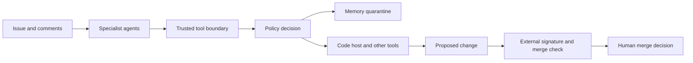

# Architecture and boundaries

The reference workflow starts with a developer issue. An agent reads issue/comments, may save a lesson, and proposes tool calls. Public context can influence actions carrying private authority.

`policies/agent` expresses role scoping, task/repository checks, approval binding, delegation and memory state. `policies/merge` inspects a decision record against the current PR revision and configured human approvers. `attest` builds statement data. `fga` expresses the intended relationship model.

The trusted boundary must provide authenticated caller identity, task scope, provenance/taint and canonical argument hashes. The model must not author those facts. Verify signature and current head revision outside the agent before asking the merge policy for a decision.

The conceptual system is broader than the prototype. [Known limitations](KNOWN-LIMITATIONS.md) describe which integrations and enforcement properties are not established by the included cluster source.
